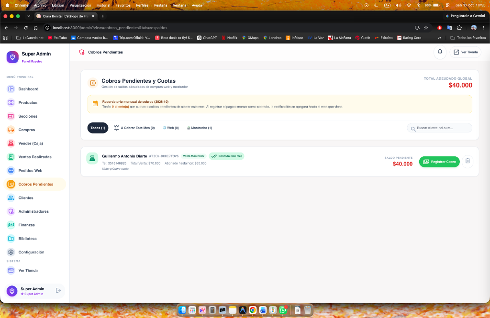
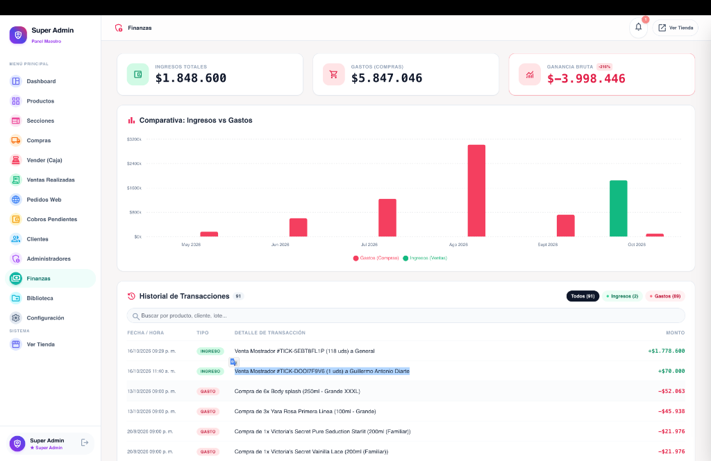
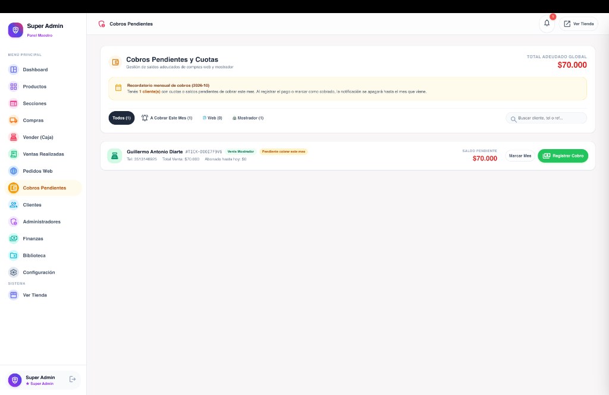
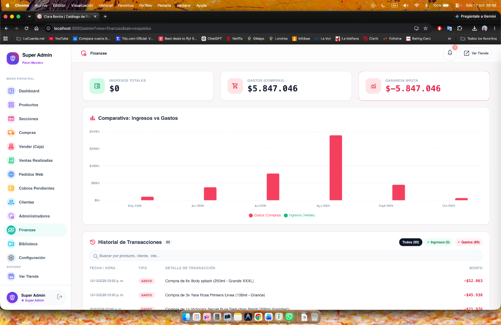

# 🌸 Ciara Bonita — Plataforma Integral de Perfumería & Cosmética
### *E-Commerce Catálogo Web + Punto de Venta (POS) + Gestión de Cuotas y Finanzas*

[](https://nextjs.org/)
[](https://react.dev/)
[](https://www.typescriptlang.org/)
[](https://tailwindcss.com/)
[](https://www.prisma.io/)
[](https://www.sqlite.org/)
[](https://www.docker.com/)

---

## 📌 Resumen Ejecutivo

**Ciara Bonita** es una plataforma web integral **Full-Stack** diseñada para digitalizar, potenciar y profesionalizar la gestión comercial de negocios de perfumería, cosmética, estética y moda. 

Combina en una sola solución:
1. Una **tienda online moderna y catálogo interactivo** para los clientes finales.
2. Un **Punto de Venta Mostrador (POS / Caja)** de alta velocidad para atención presencial.
3. Un **módulo de cobros diferidos y gestión de cuotas** para ventas a crédito o pagos parciales con recordatorios inteligentes automáticos.
4. Un **dashboard analítico de finanzas** con gráficos y balance neto real.
5. Un **sistema de copias de seguridad (backups)** automáticas con rotación programada de 7 días.

---

## 🎯 ¿A qué público está enfocado?

Este sistema ha sido diseñado específicamente resolviendo necesidades reales de negocio:

* **Perfumerías, Boutiques y Comercios de Cosmética:** Negocios que manejan fragancias, maquillajes, cremas y accesorios con múltiples variantes (tamaños, presentaciones, familias olfativas, tonos).
* **Comercios con modalidad física y digital híbrida:** Negocios que venden en mostrador (atención al público presencial) y a su vez reciben pedidos a través de su sitio web o catálogo digital por WhatsApp.
* **Negocios con venta a crédito o cuotas:** Tiendas que ofrecen financiamiento propio, pagos en 2, 3 o más partes, señas o cuentas corrientes y requieren saber con exactitud **cuánto pagó el cliente, cuánto adeuda y recibir alertas mensuales**.
* **Cartera de Desarrollo / Portfolio Profesional:** Demostración de arquitectura de software full-stack moderna, diseño de interfaces refinado, optimización SEO, gestión de estados complejos y robustez en persistencia de datos.

---

## 📸 Módulos Principales del Sistema

### 1. 🛍️ Catálogo Web Público & E-Commerce
Interfaz pública moderna, rápida y adaptable a cualquier dispositivo móvil o de escritorio. Los clientes pueden explorar fragancias por marcas y familias olfativas, verificar disponibilidad y armar su pedido al instante.


- **Diseño Responsive & Mobile-First:** Experiencia fluida para compras desde teléfonos móviles.
- **Filtrado Avanzado:** Clasificación instantánea por género, notas olfativas y marcas exclusivas.
- **Carrito de Compras Persistente:** Mantiene los productos seleccionados y permite finalizar el pedido con integración directa a WhatsApp o generación de orden en el sistema.

---

### 2. 💳 Gestión de Cobros Pendientes & Cuotas
Módulo especializado para resolver el seguimiento de saldos y créditos otorgados en ventas presenciales u online.



- **Desglose Financiero Tripartito Claro:** Cada tarjeta exhibe en primer plano y con colores diferenciados:
  - 🏷️ **Total Venta:** Monto original del ticket o compra.
  - 💵 **Abonado:** Importe que el cliente ya abonó hasta la fecha.
  - ⚠️ **Adeuda:** Saldo pendiente por cobrar en color de alto contraste.
- **Recordatorio Mensual Inteligente:** Si un cliente mantiene deuda activa, el sistema genera automáticamente una alerta mensual en el panel y en la campana de notificaciones. Al registrar el cobro, la alerta se silencia hasta el próximo mes calendario.
- **Modal de Cobro Dinámico:** Permite ingresar amortizaciones con notas o comprobantes y actualizar el saldo en tiempo real.

---

### 3. 📊 Dashboard de Finanzas & Métricas Analíticas
Toma de decisiones basada en datos reales, diferenciando lo efectivamente cobrado de lo adeudado.



- **4 Indicadores Clave (KPIs):**
  - **Ingresos Cobrados:** Dinero líquido efectivamente ingresado en caja o banco.
  - **Cobros Pendientes (en amarillo):** Dinero en la calle correspondiente a cuotas o saldos adeudados.
  - **Gastos Operativos:** Registro y deducción de egresos y costos del negocio.
  - **Balance Neto:** Rentabilidad y salud financiera real del período.
- **Gráficos Interactivos Multivariable (Recharts):** Gráfico mensual de 3 barras comparativas (Cobrado, Pendiente y Gastos) para análisis visual instantáneo.

---

### 4. 🧾 Punto de Venta Mostrador (POS / Caja) e Historial
Gestión operativa del mostrador con alta velocidad de despacho.



- **Caja Rápida:** Búsqueda en milisegundos de productos, selección de variantes y múltiples métodos de pago (Efectivo, Transferencia, Tarjeta, Cuotas, Cuenta Corriente).
- **Emisión y Envío de Comprobantes:** Generación de recibos listos para imprimir o compartir mediante enlace directo a WhatsApp.
- **Control de Auditoría y Roles (Super Admin):** Permite a los administradores principales cancelar ventas erróneas o cobros mal generados, restituyendo automáticamente el inventario al stock.

---

### 5. 🛡️ Respaldo de Base de Datos y Backups Automáticos
Seguridad y tranquilidad operativa para evitar cualquier pérdida de información.



- **Respaldos Manuales con 1 Clic:** Creación y descarga instantánea de snapshots completos del sistema en formato `.zip` y base de datos.
- **Política de Retención Automática de 7 Días:** Script y endpoints automatizados que conservan los backups de la última semana y purgan automáticamente copias antiguas para preservar el espacio en disco del servidor.
- **Restauración Sencilla:** Carga y reemplazo seguro de bases de datos desde el propio panel de control.

---

## 🛠️ Stack Tecnológico & Decisiones de Arquitectura

| Capa / Componente | Tecnología | Razón de Elección |
| :--- | :--- | :--- |
| **Frontend Framework** | **Next.js 14 (App Router)** | Renderizado híbrido (SSR / RSC), velocidad de carga, rutas optimizadas y SEO listo para catálogo público. |
| **Lenguaje** | **TypeScript 5** | Tipado estricto de extremo a extremo, previniendo errores en transacciones monetarias y manipulación de inventario. |
| **Estilos & UI** | **TailwindCSS 3.4** | Diseño personalizado moderno con soporte nativo de Dark/Light mode, micro-animaciones y diseño responsivo. |
| **Gestión de Estado** | **Zustand** | Estado reactivo para la caja registradora (POS) y carrito con sincronización y persistencia local sin sobrecargar el servidor. |
| **Gráficos & BI** | **Recharts** | Gráficos vectoriales SVG dinámicos y fluidos adaptados a las métricas financieras del negocio. |
| **Base de Datos & ORM**| **Prisma ORM + SQLite** | Arquitectura ligera y atómica que no requiere servicios pesados externos; portable y lista para migrar a PostgreSQL si el volumen lo requiere. |
| **Seguridad & Roles** | **BCrypt + JWT + Role Guard** | Control de acceso granular para Super Administradores y Vendedores/Editores. |
| **Infraestructura** | **Docker & Docker Compose** | Despliegue en 1 comando, compatible con VPS, Dokploy, Coolify y servidores propios con volúmenes persistentes. |

---

## 💻 Guía de Instalación y Ejecución Local

Puedes ejecutar este proyecto en tu entorno de desarrollo en menos de 3 minutos:

### Requisitos Previos
- **Node.js** v18.x o superior
- **npm** v9.x o superior
- *(Opcional)* **Docker Desktop** si prefieres correrlo en contenedores

---

### Opción 1: Ejecución Rápida Nativa (Recomendada)

1. **Clonar el repositorio:**
   ```bash
   git clone https://github.com/tu-usuario/perfumeria-ciara-bonita.git
   cd perfumeria-ciara-bonita
   ```

2. **Instalar dependencias y generar el cliente de base de datos:**
   ```bash
   cd frontend
   npm install
   npx prisma generate
   ```

3. **Iniciar el servidor de desarrollo:**
   ```bash
   npm run dev
   ```

4. **Abrir en tu navegador:**
   - **Catálogo y Tienda Pública:** [http://localhost:3000](http://localhost:3000)
   - **Panel de Administración:** [http://localhost:3000/admin](http://localhost:3000/admin)

> 💡 **Credencial de Acceso para Demostración:**
> - **Clave de Super Admin:** `Gad33224122`

---

### Opción 2: Ejecución con Docker Compose

Si cuentas con Docker instalado:

```bash
docker compose up --build
```

El sistema iniciará automáticamente el contenedor y mapeará el almacenamiento persistente en `./data` y `./uploads`.

---

## 🗂️ Estructura del Proyecto

```text
├── docs/
│   └── screenshots/         # Capturas de pantalla reales en alta resolución para portafolio
├── frontend/
│   ├── prisma/              # Esquema de base de datos y migraciones (schema.prisma, dev.db)
│   ├── public/              # Recursos estáticos, logos e íconos PWA
│   ├── src/
│   │   ├── app/
│   │   │   ├── admin/       # Panel maestro de control administrativo
│   │   │   ├── api/         # Route Handlers de Next.js (Endpoints REST internos)
│   │   │   └── page.tsx     # Landing page y catálogo público
│   │   ├── components/      # Componentes modulares (Admin, POS, Finanzas, UI)
│   │   ├── store/           # Stores Zustand (useStockStore para POS y ventas)
│   │   └── utils/           # Utilidades de formateo de moneda, fecha y API helpers
│   ├── package.json
│   └── tailwind.config.ts
├── scripts/
│   └── backup.sh            # Script de ejecución y depuración de copias de seguridad
├── DEPLOY.md                # Guía paso a paso para despliegue en VPS (Dokploy / Coolify)
├── docker-compose.yml       # Orquestación de contenedores
└── README.md                # Documentación principal del proyecto
```

---

## 👤 Autor & Contacto

Desarrollado con pasión por la creación de software robusto, estético y centrado en la resolución de problemas comerciales reales.

- **Desarrollador:** Guillermo Diarte
- **Especialidad:** Full-Stack Web Developer (Next.js, React, Node.js, Python, TypeScript)
- **Repositorio:** [GitHub](https://github.com/guillermodiarte)

---
*Si este proyecto te ha resultado útil o interesante para tu negocio o portafolio, ¡no dudes en dejar una estrella ⭐!*
